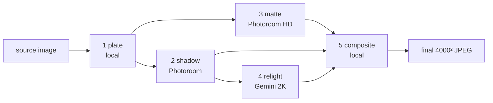

# Pipeline specification

What the pipeline does, stated so it can be re-implemented in any language. Verified against
`scripts/run_pipeline.mjs` and `src/*.mjs` at commit `5236c2b` on 2026-10-15; the code was refactored on
2026-10-19 with byte-identical output on all eleven composite paths (`scripts/check_composite.sh`).

"Must" marks behaviour the output depends on. "Prototype" marks a choice of this implementation
that a re-implementation may change. Why each constant has its value: `docs/decisions.md`.
Every flag and config key: `docs/configuration.md`.

## 1. Contract

### Input

| Property | Requirement | What happens otherwise |
|---|---|---|
| Content | One product, photographed on a plain white or near-white background (IKEA "main product picture", `_pe` studio shot). | Lifestyle shots and multi-product scenes are out of scope; behaviour is undefined. |
| Format | JPEG, PNG or WebP (extension match, case-insensitive). | Other files are ignored by input collection. |
| Size | Any. Observed 804×4000 to 7402×4692; the IKEA CDN serves at most 2000×2000. | No minimum is enforced. Small sources are upscaled by Photoroom, not by the plate. |
| Background | Plated path: product pixels must be darker than luminance 245 somewhere, or the plate cannot find them. | All-white input fails the SKU: `no subject detected`. Off-white sources (backdrop ≈244, newer IKEA renders) make the plate select the whole frame; Photoroom's own detection then rescues framing (`docs/categories.md`, group `offwhite`). |
| Colour | Any embedded ICC profile. | Converted to sRGB on decode (verified: the Adobe RGB 1998 originals decode to within 0.1 level of a Pillow ICC conversion). |
| Alpha | Not expected. | The plate drops alpha; transparent pixels become whatever RGB lies under them. Prototype gap. |
| Identity | SKU = filename without extension. | **Two different images with the same SKU name share every cache entry.** See section 7. |

### Output

| Property | Value |
|---|---|
| Size | 4000 × 4000 px, never downsampled. |
| Framing | Product bounding box ≤ 3200 px on its long axis, ≥ 400 px margin on every side. Photoroom scatters ±3 px; measured 3185–3202 px / 399–407 px across every category tested. |
| Background | The configured `bg` hex, exactly, outside the product and the cast shadow. |
| Format | JPEG, quality 95, 4:2:0 chroma, 72 dpi, **sRGB with no embedded ICC profile**. Exception: `render-only` with relight off writes Photoroom's JPEG unchanged, which carries Photoroom's embedded profile and its own quality setting. |
| Product pixels | From Photoroom's matte, which returns the **plate's** pixels: source pixels, except that the plate whitens anything brighter than luminance 239 (section 3.1). Then multiplied by the relight factor and passed through the highlight shoulder. Never from a generative model. Exceptions: glass modes, section 4. |
| Location | `<out>/<group path>/<sku>.jpg`, mirroring the input folder; top-level inputs land directly in `<out>/`. |

## 2. Stage graph



Execution order in the prototype is plate, shadow, matte, relight, composite; shadow and matte are
independent and may run in parallel. Each external stage writes a cache file and is skipped when it
exists (section 7).

| Mode | Plate | Shadow | Matte | Relight | Calls per SKU |
|---|---|---|---|---|---|
| `opaque` (default) | `makePlate` | yes, on white | yes | yes unless `relight: false` | 2 Photoroom + 1 Gemini |
| `opaque`, relight off | `makePlate` | yes | yes | no | 2 Photoroom |
| `transparent` | `squarePlate` | yes, on white | yes | yes unless off | 2 Photoroom + 1 Gemini |
| `render-only` | `squarePlate` | yes, **on the target bg** | only if relight on (used as a mask) | yes unless off, glass prompt | 2 + 1 with relight; 1 Photoroom without |
| any, `--no-plate` | none: raw source sent | yes | yes | as above | as above |

No glass `group.json` currently sets `relight: false`, so glass runs at 2 Photoroom + 1 Gemini.

Changing `bg`, `strength`, `highlights`, `shade` or `exposure` re-runs only the composite (zero calls),
except in `render-only`, where a new `bg` needs a new shadow render and, with relight on, a new Gemini call.

## 3. Stages

### 3.1 Plate (`src/plate.mjs`)

`makePlate` (opaque path):
1. Decode to sRGB, drop alpha.
2. Subject box = tight bbox of pixels with luminance `0.299R + 0.587G + 0.114B < 245`.
3. Crop to that box; scale uniformly so the long side ≤ 3200 px, **never up** (lanczos3).
4. Build an alpha from luminance on the scaled crop: `α = clamp((245 − L) / 6, 0, 1)`.
5. Place the RGBA crop centred on a transparent 4000² canvas; flatten onto white; encode PNG.

**Step 4 changes product pixels.** Any pixel brighter than luminance 245 becomes pure white, and
pixels between 239 and 245 are blended toward white, including bright areas inside the product. On
white and near-white products this flattens highlight texture before Photoroom sees it. Combined with
the shoulder (section 3.5), a bright white source pixel ends at 248 in the final.

`squarePlate` (glass modes): contain-fit the whole source onto 4000² white, no detection, because the
luminance threshold cuts off bright glass rims.

The plate does not set the final framing. Photoroom re-detects the product and applies `padding`
(section 3.2). The plate's job is to present one centred product on clean white.

### 3.2 Shadow (`src/photoroom.mjs`)

`POST https://image-api.photoroom.com/v2/edit`, multipart, headers `x-api-key`,
`pr-ai-shadows-model-version: 2026-04-15`. Fields:

| Field | Value |
|---|---|
| `imageFile` | the plate |
| `shadow.mode` | `ai.auto-with-overrides` |
| `shadow.softnessOverride` / `intensityOverride` / `spreadOverride` | `long`: 0.6 / 0.55 / long. `short`: 0.75 / 0.5 / short. |
| `shadow.directionOverride` | `long` only: `behindRight` (light from front-left) |
| `shadow.subjectPoseOverride` | `upright` (default) or `flatlay` |
| `background.color` | `FFFFFF`, or the target bg in `render-only` |
| `outputSize` | `4000x4000`. **Never** `originalImage`: it fits the product edge to edge, losing the margin and clipping the shadow. |
| `padding` | `0.10` plated, `0.0838` with `--no-plate` |
| `referenceBox` | `originalImage` with `--no-plate`, otherwise unset |
| `export.format` | `jpeg` |

Output: product plus cast shadow on the background, 4000². **Non-deterministic**: repeated calls differ,
and on multi-leg furniture one leg's shadow occasionally points the wrong way.

### 3.3 Matte (`src/cutout.mjs`)

Same endpoint and key. Fields: `imageFile`, `removeBackground=true`, `outputSize=4000x4000`, `padding`
(same value as 3.2, **must** match), `referenceBox` (same as 3.2), `export.format=png`. Header
`pr-hd-background-removal: auto` unless `--no-hd`.

Output: RGBA PNG. RGB is the source's own pixels; alpha is a straight, anti-aliased coverage mask.
Because both calls pad around the same detected product, the matte and the shadow render frame it
identically within ~7 px. **That shared frame is why the composite needs no alignment.** Photoroom is
used rather than a local matting model because BiRefNet failed on fur and glass.

### 3.4 Relight (`src/gemini.mjs`)

Model `gemini-3-pro-image-preview`, `temperature: 0`, `imageConfig: { aspectRatio: "1:1", imageSize: "2K" }`.
Input: the shadow render, contain-fit to 2048² on white, JPEG q92. Prompt: `RELIGHT_VARIANTS.standard`
(opaque, transparent) or `RELIGHT_VARIANTS.glass` (render-only); text in `src/gemini.mjs`.

Output: a 2048² image. **It is never used as pixels.** It is consumed only as the lighting map `L`:

```
L = luma( blur_σ20( resize_fill(relit, 4000²) ) )        # luma = 0.299R + 0.587G + 0.114B
```

Non-deterministic in practice even at temperature 0.

### 3.5 Composite (opaque and transparent)

Per pixel, with `a = matte_alpha / 255`, `S` = matte RGB, `B` = shadow render RGB, `bg` = target colour:

```
μ      = Σ(L·a) / Σa                                     # alpha-weighted mean of the lightmap
d      = (L − μ) / 128
up     = 1 if highlights=on, 0 if off, headroom(S, a) if auto
f      = 1 + (d < 0 ? d·shade : d·up) · strength
fe     = f · exposure
P      = shoulder(S · fe)                                # product term, per channel

opaque:       sf  = (a·255 + (1−a)·luma(B)) / 255        # cast-shadow factor, product masked out
              out = P·a + bg·sf·(1−a)
transparent:  k   = smoothstep(0.85, 1.0, a)
              out = P·k + B·(1−k)
out = clamp(out, 0, 255)
```

With relight off, `L ≡ 0`, so `μ = 0`, `d = 0`, `f = 1`. With `bg = FFFFFF` the background term reduces
to the raw shadow render.

**Edges.** There is no feather, erosion, dilation or decontamination step. Clean edges come from two
structural facts: the shared frame (no misregistration, so no halo or double edge) and straight
anti-aliased alpha (the matte's sub-pixel coverage blends the subject's own edge into whatever `bg`
is chosen). Every align-after-the-fact approach tried produced halos.

**Highlight shoulder.** `shoulder(v) = v` for `v ≤ 236`; above it, `255 − 19·exp(−(v − 236)/19)`.
Monotonic and C1-continuous. **It applies to every product pixel in `opaque` and `transparent`, including relight off and
`highlights: off`, and in `render-only` with relight on.** Only `render-only` with relight off skips it. Effect at f = 1: 240 → 239.6, 245 → 243.2, 250 → 245.9, 255 → 248.0. Measured on
PE774419 (white armchair), no relight: 20.1% of opaque product pixels are ≥ 250 in the matte, 0.24% in the
final. Whether this is intended is an open question for the owners (`docs/handoff-backend.md`).

**Headroom (`highlights: auto`).** Over pixels with alpha ≥ 200, take the per-pixel max channel. Body =
all such pixels; edge = those with any pixel 3 px away (left, right, up, down) below alpha 200.
`scale(x) = clamp((255 − p90(x) − 5) / 25, 0, 1)`; `headroom = min(scale(body), scale(edge))`.

### 3.6 Composite (render-only)

Relight off: the final **is** the shadow render, written byte-for-byte.

Relight on: same `μ`, `d`, `up` (headroom measured on `B`), then

```
f   = 1 + (d < 0 ? d·shade : d·up) · strength · a        # relight confined to the product by alpha
v   = B · f
out = clamp( v·(1−a) + shoulder(v)·a )
```

`exposure` is not applied in this mode. The matte supplies alpha only; its RGB is never used.

## 4. Invariants

These hold for the opaque path. Each was learned by breaking it; the history is in `docs/decisions.md`.

1. **One shared frame.** Matte and shadow use the same `padding` and `referenceBox`. No alignment,
   resampling, bbox-matching, dilation or feathering in the composite.
2. **Product pixels come from the matte.** Not from the shadow render (soft), not from Gemini (redrawn).
   Exceptions: `transparent` takes see-through regions from the render; `render-only` uses the render only.
3. **Gemini output is never pixels.** Lighting map only, 2K, temperature 0, blurred.
4. **Cast shadow comes from Photoroom.** No procedural shadow.
5. **Finals are 4000², never downsampled.**
6. **Cache identity covers every parameter that changes a stage's output.** The prototype violates this
   in five ways (section 7).
7. **Photoroom form fields are dotted** (`shadow.*`, `background.color`, `export.format`); the client sets
   the multipart boundary.

## 5. Failure behaviour (prototype)

| Event | Behaviour |
|---|---|
| Config invalid (bad mode, pose, shade, exposure, highlights, bg) | Whole run exits before any work. |
| No subject on plate | That SKU fails; run continues. |
| Photoroom non-2xx | That SKU fails. No retry, no backoff. |
| Gemini returns no image | That SKU fails; run continues. No retry. |
| Any SKU error whose message contains `429` | The run stops, whichever service raised it. |
| Some SKUs failed | Listed in the summary; **the process still exits 0**. |
| Wrong-way leg shadow, blank shadow | Not detected. Manual fix: delete the SKU's `shadow*`, `relit*`, `final*` and re-run. |
| Interrupted run | Resumes from cache on re-run. Cache writes are not atomic and a file's existence is treated as a hit, so a write interrupted mid-file leaves a truncated file that later runs reuse. Delete the SKU's work folder after a crash. |

## 6. Determinism

Plate and composite are deterministic. Shadow and relight are not. A final is reproducible only from
its cached shadow, matte and relit files, which is why the prototype keeps them.

## 7. Cache identity (prototype)

Work directory: `outputs/work/<sku>/`. File names encode parameters as suffixes; grammar and every
suffix are in `docs/configuration.md`. Known gaps:

- **No source hash.** The key is the SKU name. A changed or different source with the same name reuses
  stale stages. VEDBO PE638683 is in both `group_chair` and `group_dark`; today that is the same image.
- **Relight on/off is not in the final's key.** Switching it reuses the previous final. Delete
  `final*` to force a re-render.
- **Mode is not in the shadow, matte or relit key.** Mode chooses the plate (`makePlate` or `squarePlate`)
  and the Gemini prompt (standard or glass), so switching a SKU from opaque to a glass mode on white reuses
  renders made from the opaque plate, whose luminance crop can cut glass rims, and a lightmap made with
  the wrong prompt. Delete the SKU's work folder when its mode changes.
- **Parameters are rounded to hundredths** in file names (`_st`, `_e`, `_sh`), so strength 0.252 and
  0.254 share a final.
- **No model, prompt or code version** is in any key. A Photoroom model change, a prompt edit or a
  composite change silently reuses old stages.

## 8. Contact sheets (prototype)

One per output group: 300 px cells, 6 columns, SKU label, JPEG q88. Path is `--sheet`, with
`_<group>` appended for grouped inputs. Review aid only.
